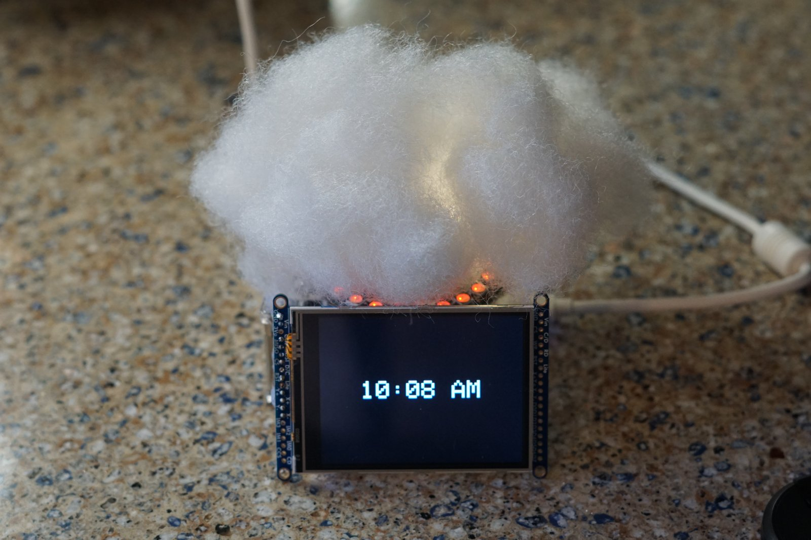
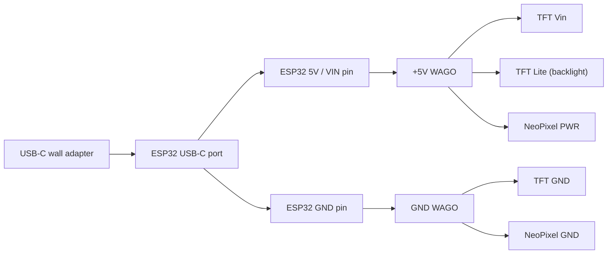
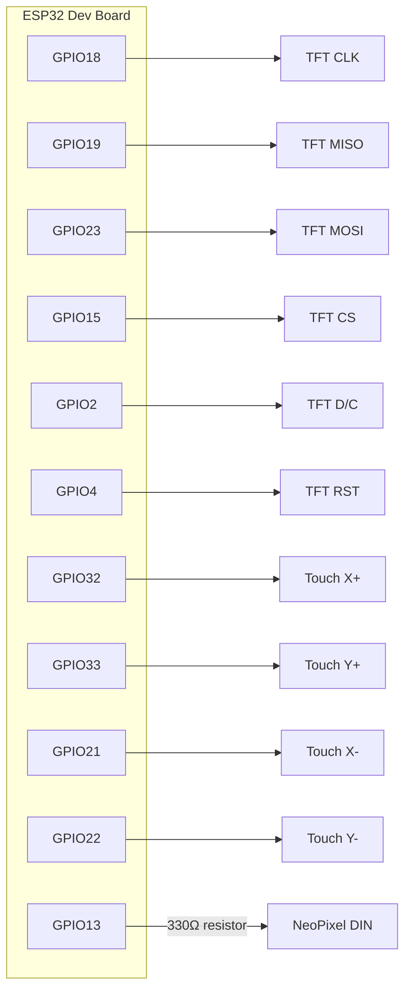

# Cloud Lamp

A pair of internet-connected "cloud" lamps for two people in different places. Tap
the screen on one lamp and the other one lights up.

## Why I built this

There are plenty of products for staying connected with someone far away, and a lot
of the nicest ones are jewelry: bracelets and rings that buzz or glow when the other
person taps theirs. The problem is, I can't wear jewelry. So instead of going without,
I built my own version that sits on a desk or nightstand.

Each lamp shows a clock, and tapping the screen sends a "blink" to the other lamp: a
short animation on its LED ring. When idle, the ring doubles as a 24-hour sun/moon
dial showing what time it is where the *other* lamp lives, so you always know whether
they're probably asleep.

It's built around an ESP32, a 3.2" touchscreen, and a 24-LED RGBW NeoPixel ring,
covered in polyester fiberfill to make the cloud. Without the fluff it's a glowing
ring lamp (friends say it looks like an arc reactor), which works too.

## Status

**Working:**
- NTP-synced clock on the screen (12-hour, timezone set per lamp)
- Tap-to-blink: sends an MQTT message to the paired lamp, which plays a flash
  animation on its LED ring (warm gold when you send, pink when you receive) and
  shows a message on its screen
- Idle LED ring shows the other lamp's local time as a 24-hour sun/moon dial
- A few built-in holiday/anniversary animations
- Automatic WiFi recovery, including after multi-day outages

**Ideas, not built yet:** weather-driven light modes, a backlog of missed blinks,
an on-screen button UI, brightness controls, WiFi setup without editing code, and
BLE presence (see the [note at the bottom](#ble-presence-idea)).

## Hardware

| Part | What I used |
|---|---|
| MCU | ESP32 dev board with USB-C (ESP-WROOM-32, e.g. ELEGOO 3-pack). Any ESP-WROOM-32 board with the same pins works. |
| Display | [Adafruit 3.2" TFT touchscreen breakout](https://www.adafruit.com/product/1743), ILI9341, 90.0 × 60.0 × 7.9 mm |
| Touch | 4-wire resistive touch (built into the TFT breakout) |
| LEDs | [Adafruit NeoPixel ring, 24 × 5050 RGBW](https://www.adafruit.com/product/2862), Natural White ~4500K, OD 65.5 mm / ID 52.2 mm |
| Resistor | 330Ω on the NeoPixel data line |
| Wiring | 2 WAGO lever connectors (one +5V rail, one GND rail), jumper wires, hot glue |
| Power | A USB-C wall adapter plugged straight into the ESP32 (2A or more recommended) |
| Enclosure | Acrylic stackable Raspberry Pi case (any small box that fits the parts works) |
| Cloud | Polyester fiberfill (Poly-Fil) hot-glued around the enclosure |

### Power wiring

The whole lamp runs off the ESP32's own USB-C port. The ESP32's 5V pin feeds a +5V
WAGO, its GND pin feeds a GND WAGO, and the screen and LED ring connect to those.

- Everything draws its current through the ESP32 board, so the firmware caps LED
  brightness (default 40/255, never above 120) to stay well within what the board's
  USB input can supply. Raise those limits carefully.
- The TFT backlight (`Lite`) is tied straight to +5V, so it's always on.
- Optional: a 1000µF capacitor across +5V/GND at the ring helps smooth LED current
  spikes. Mine runs fine without one at these brightness levels.

### Signal wiring

| ESP32 pin | Connects to | Notes |
|---|---|---|
| GPIO18 | TFT CLK | hardware VSPI |
| GPIO19 | TFT MISO | |
| GPIO23 | TFT MOSI | |
| GPIO15 | TFT CS | |
| GPIO2 | TFT D/C | |
| GPIO4 | TFT RST | |
| GPIO32 | Touch X+ | must be an ADC1 pin (ADC2 doesn't work while WiFi is on) |
| GPIO33 | Touch Y+ | must be an ADC1 pin |
| GPIO21 | Touch X- | |
| GPIO22 | Touch Y- | |
| GPIO13 | NeoPixel DIN | through a 330Ω series resistor; DOUT unused |
| GPIO5 | *(free)* | reserved for SD card CS if SD support is added later |

Touch calibration constants and other tunables are commented at the top of
[`cloud_lamp.ino`](firmware/cloud_lamp/cloud_lamp.ino).

## How the lamps talk: HiveMQ Cloud

The two lamps never connect to each other directly. Both connect over TLS (port 8883)
to an MQTT broker. I use a free [HiveMQ Cloud](https://console.hivemq.cloud) cluster,
but any MQTT broker works.

| Topic | Who publishes | What it carries |
|---|---|---|
| `cloudlamp/<LAMP_ID>/command` | the *other* lamp | blinks sent to this lamp |
| `cloudlamp/<LAMP_ID>/status` | this lamp (retained) | its local hour, for the partner's sun/moon dial |

Nothing in this repo talks to a broker I own. You set up your own HiveMQ cluster and
put its address and credentials in `secrets.h` (see below).

> **Security note:** the firmware currently skips TLS certificate validation
> (`espClient.setInsecure()`). Traffic is encrypted but the broker's identity isn't
> verified. Pinning HiveMQ's root CA with `setCACert()` is on the to-do list, and PRs
> are welcome.

## Getting started

1. **Get an enclosure.** I used an acrylic stackable Raspberry Pi case. Any small box
   that fits the ESP32, screen, and ring will do.
2. **Wire it up** using the diagrams above.
3. **Flash the firmware.** Follow
   [`firmware/cloud_lamp/INSTALL.md`](firmware/cloud_lamp/INSTALL.md). It walks
   through installing the Arduino IDE, ESP32 board support, the libraries, and creating
   your own `secrets.h`, assuming no prior experience.
4. **Do it again for the second lamp**, with `LAMP_ID` / `OTHER_LAMP_ID` swapped and
   `LAMP_TZ` set to where that lamp lives.
5. **Add the cloud.** Test everything first, then hot-glue fiberfill around the
   enclosure, leaving the screen and ring uncovered (or skip it for the ring-lamp look).

## Repository layout

| Path | What it is |
|---|---|
| [`firmware/cloud_lamp/`](firmware/cloud_lamp) | Arduino sketch for the ESP32, plus `INSTALL.md` and `secrets.h.example`. |
| [`docs/`](docs) | Images used in this README. |

`firmware/cloud_lamp/secrets.h` holds your real WiFi/MQTT credentials and is
gitignored. Copy `secrets.h.example` to `secrets.h`, fill it in, and never commit it.

## BLE presence idea

One feature I'd like to add: using the ESP32's built-in Bluetooth LE to notice when
your phone is near your lamp, so the other lamp can show that you're home and
nearby. The hardware already supports it, so this would be firmware only. If you
build it, I'd love a PR.

## License

[PolyForm Noncommercial 1.0.0](LICENSE). You're welcome to read the code, build
lamps for yourself and the people you care about, modify it, and share your changes,
as long as it's not for commercial use. **Selling lamps built from this project, or
selling the code, is not permitted.** If you'd like to use it commercially, open an
issue and ask.
